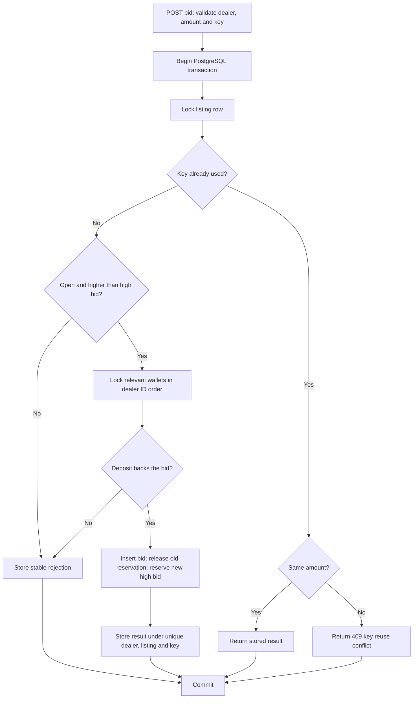

# Auction Bid Service

Independent portfolio demonstration using fictional auction and inspection data. The Laravel 13 / Livewire 3 app starts with 40 vehicle lots, 10 fictional number plates, 20 demo dealers, deposit-backed bidding, simulated top-ups, two-second polling, and visible bid-change animations. Vehicle photos are representative real models, not photos of the fictional lots. **This project is not affiliated with SellAnyCar.com.**

The [public Dealer Portal](https://dealers.sellanycar.com/#/en/home) is background for inspected cars, a deposit-backed limit, and 12-minute Live / 72-hour Deal offers. All dealer identities, lots, inspections, bid rules, and top-ups here are independent demo behavior. The project direction is recorded in [the product brief](auction-bid-service-product-brief.md) and [Laravel workflow](laravel-production-workflow.md).

## Two-minute browser review

No deployed URL has been verified. After [local setup](#local-setup), open <http://localhost:8000>:

1. Use the rounded avatar menu to choose a fictional dealer such as `D-001`. Open a **Live** or **Deal** listing and read its inspection summary, high bid, bidder code, and bid history.
2. Enter a whole-AED bid above the displayed high bid. The page shows the accepted bid and updated available limit. Try the same or a lower amount to see a business-rule error. The inventory page keeps wallet balances out of view.
3. Open **Wallet management** from the avatar to see deposit, active reservations, available limit, and a simulated AED 10,000 or AED 50,000 top-up. No money moves.
4. For a two-browser walkthrough, open the same listing in a second browser or private window, choose `D-002`, and outbid `D-001`. Return to the first window: polling updates the leader, “You” marker, history, and limit within roughly two seconds. On the inventory page, recent bid activity moves the listing card forward; changed values flash. Background tabs may pause polling until visible again.

## Requirements

- PHP 8.4 with `pdo_pgsql` and `pcntl` for the concurrency test
- Composer 2
- Node.js 22.20.0 and npm (see `.nvmrc`)
- Docker Compose for PostgreSQL 17, or an equivalent local PostgreSQL 17 instance

## Local setup

Copy `.env.example` to `.env` and set your own `DB_PASSWORD` there. The example uses `127.0.0.1:55432`, database `sac_auction`, and user `sac_auction`. From the repository root:

```sh
cp .env.example .env
# Edit DB_PASSWORD in .env before continuing.
docker compose up -d --wait
docker compose exec -T postgres sh -c 'createdb -U "$POSTGRES_USER" sac_auction_test'
composer install --no-interaction --prefer-dist
npm ci
php artisan key:generate --no-interaction
php artisan migrate --seed --no-interaction
npm run build
php artisan serve --no-interaction
```

Run `createdb` only once per new Docker volume. `phpunit.xml` points tests to `sac_auction_test` on PostgreSQL at `127.0.0.1:55432`; the test suite migrates that database. [CONTRIBUTING.md](CONTRIBUTING.md) lists the checks and branch conventions. With an existing PostgreSQL server, create both databases and set its connection values in `.env`. If the test host or port differs, export `DB_HOST` and `DB_PORT` when running `php artisan test` so they override the PHPUnit defaults.

Laravel uses file sessions and cache plus a synchronous queue. The application database holds the seeded auction data.

The inventory dashboard does not show wallet balances. The bid form shows only the available limit needed to judge a bid. Full wallet balances, simulated top-ups, and wallet activity live on the Wallet management page. Public bid history displays bidder codes, not dealership names.

JSON endpoints are versioned under `/api/v1`. Public reads include `/api/v1/listings` and `/api/v1/listings/{listing}/bids`. A selected Demo dealer session is required for `GET /api/v1/wallet` and `POST /api/v1/listings/{listing}/bids`. The POST body is `{"amount_aed": 21000}` and requires an `Idempotency-Key` header. Accepted bids return HTTP 201 with the Bid and Wallet summary; business-rule rejections return HTTP 409 with a stable error code. Invalid input returns 422; missing selection returns 401.

The same selected session can call `POST /api/v1/wallet/top-ups` with `{"amount_aed": 10000}` or `{"amount_aed": 50000}` and an `Idempotency-Key` header. The top-up is fictional: no card, bank, or payment details are collected. `GET /api/v1/wallet` includes top-up activity with amount and time. `app/Actions/TopUpWallet.php` locks the Wallet, credits it once, and stores the original response under a wallet-scoped unique key. A retry returns that response; a changed amount with the same key returns 409. Use a new key for a new top-up or a new bid attempt after topping up.

## Bid transaction

[`PlaceBid`](app/Actions/PlaceBid.php) owns the state change. [`BidPlacementTest`](tests/Feature/BidPlacementTest.php) exercises it through HTTP and Livewire. The key tables are `auction_listings`, `bids`, `wallets`, `bid_reservations`, `bid_attempts`, and `wallet_top_ups`.



Money is stored as integer AED fils. Available limit is deposit minus active reservations; raising your own high bid substitutes its old reservation when checking capacity. A closed winning bid stays reserved because settlement is outside the demo. Row locks serialize writes to a listing and relevant wallets; a database unique constraint protects bid idempotency. Rejected attempts leave no bid or reservation side effects.

On a dashboard visit, [`EnsureOpenOffers`](app/Actions/EnsureOpenOffers.php) creates one new 12-minute Live or 72-hour Deal listing if that type has no open listing. A PostgreSQL advisory transaction lock serializes concurrent checks. It never changes an existing closing time or clears old bids. [`TimedOfferAvailabilityTest`](tests/Feature/TimedOfferAvailabilityTest.php) checks the bid boundary and retained history; [`TimedOfferConcurrencyTest`](tests/Feature/TimedOfferConcurrencyTest.php) starts two independent PostgreSQL-backed dashboard requests together. Bid tests are sequential and do **not** prove simultaneous bid-lock behavior. The concurrency test covers offer replenishment only and skips if `pcntl` is unavailable.

## Vehicle photos and optional R2 publishing

Six representative vehicle photos are bundled under `public/images/vehicles` so the demo works without cloud credentials. Their photographers, source pages, and licenses are recorded in `config/auction_photos.php` and linked on each listing detail page. Images were resized to 960px for this demo; the original works remain on Wikimedia Commons. Listings and inspections are fictional.

To publish the bundled images to Cloudflare R2, set `R2_ACCESS_KEY_ID`, `R2_SECRET_ACCESS_KEY`, `R2_BUCKET`, and `R2_ENDPOINT` in `.env` (the endpoint is `https://<account-id>.r2.cloudflarestorage.com`). Run `php artisan app:publish-vehicle-photos-to-r2 --no-interaction`. After the objects are publicly available, set `R2_PUBLIC_URL` to the bucket's public URL or custom domain and run `php artisan config:clear --no-interaction`. The app then serves vehicle image URLs from R2. Leave `R2_PUBLIC_URL` empty until upload and public access are ready; local images remain the fallback. No credentials or bucket are included in this repository.

## Checks and scope

```sh
composer validate --strict
vendor/bin/pint --test
php artisan test --compact
npm run build
```

CI runs these checks, locked dependency installs, and migrations against a PostgreSQL 17 service on PRs and pushes to `main`. A workflow file is present; this README does not claim a remote run has passed.

This demo has no real sign-up, payments, upload proof, invoices, email, websockets, proxy bidding, delivery, settlement, or valuation logic. Dealer selection is intentionally passwordless for review. Polling updates visible state about every two seconds while a page is active. There is no cron requirement: a dashboard visit replenishes an expired offer type when needed. R2 publication is optional; bundled local photos work without cloud credentials.
